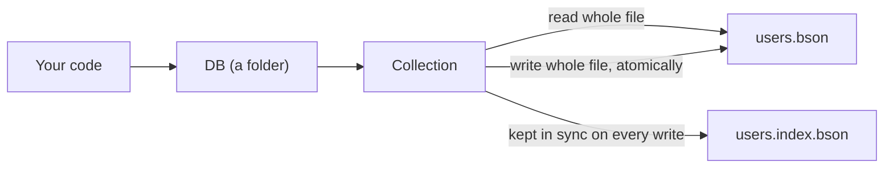

# youssefdb

A small file-based NoSQL database for Node.js with a MongoDB-style API. No server to run: each collection is one BSON file in a folder.

I designed and built it from scratch to understand how a document database works underneath: storage, queries, updates and indexes.

npm: https://www.npmjs.com/package/youssefdb

```bash
npm install youssefdb
```

## Quick start

```js
const DB = require('youssefdb');

const db = new DB();                 // stores files in ./data
const users = db.collection('users');

users.insertOne({ name: 'Alice', age: 30, city: 'Cairo' });
users.insertMany([
  { name: 'Bob', age: 25, city: 'Giza', tags: ['dev'] },
  { name: 'Cara', age: 30, city: 'Giza' },
]);

users.find({ city: 'Giza' });                        // Bob and Cara
users.findOne({ name: 'Alice' });                    // Alice, or null
users.countDocuments({ age: 30 });                   // 2

users.updateOne({ name: 'Alice' }, { $set: { age: 31 } });
users.updateMany({ city: 'Giza' }, { $set: { region: 'west' } });

users.deleteOne({ name: 'Bob' });
users.deleteMany({ age: 30 });

users.createIndex('city');                           // "city_1"
```

## How it works



- A database is a folder (default `./data`). Each collection is `<name>.bson`, holding `{ data: [ ...documents ] }`.
- Every call reads the whole collection file, works on the documents in memory, and for writes saves the whole file back.
- Writes are atomic: data goes to a temporary file that is then renamed over the old one, so a crash cannot leave a half-written file.
- Nothing is cached between calls, so every `Collection` object always sees the latest data on disk.

## API

### `new DB(options?)`

| Option | Default | |
| --- | --- | --- |
| `dir` | `./data` (from the current working directory) | Folder that holds the collection files. Created on the first write. |

- `db.collection(name)` returns the collection (the same object every time). Names use 1-64 letters, digits, `_` or `-`.
- `db.listCollections()` returns the names of the collections that have a file, sorted.

### Collection methods

| Method | Returns |
| --- | --- |
| `insertOne(doc)` | `{ acknowledged, insertedId }` |
| `insertMany(docs)` | `{ acknowledged, insertedCount, insertedIds }` — all or nothing |
| `find(query?)` | array of documents, in insertion order |
| `findOne(query?)` | first matching document, or `null` |
| `countDocuments(query?)` | number |
| `updateOne(filter, { $set })` | `{ acknowledged, matchedCount, modifiedCount }` |
| `updateMany(filter, { $set })` | `{ acknowledged, matchedCount, modifiedCount }` |
| `deleteOne(filter)` | `{ acknowledged, deletedCount }` |
| `deleteMany(filter)` | `{ acknowledged, deletedCount }` — pass `{}` to delete everything |
| `createIndex('field')` or `createIndex({ field: 1 })` | index name, e.g. `"city_1"` |
| `dropIndex('city_1')` or `dropIndex('city')` | `true` |
| `listIndexes()` | `[{ name, field }]` |
| `drop()` | `true` if files were deleted |

### Queries

- Every field in the query must match (AND), with exact, type-strict equality: `30` does not match `'30'`.
- `null` matches documents where the field is `null` or missing.
- If a stored field is an array, a single value matches any element: `{ tags: 'dev' }` matches `tags: ['admin', 'dev']`. An array value matches the whole array exactly.
- Embedded documents match by value: `{ addr: { city: 'Cairo' } }`.
- `_id` can be queried with an `ObjectId` or its 24-character hex string.
- Operators (`$gt`, `$in`, `$or`, ...), regular expressions and dotted paths (`'addr.city'`) are not supported yet and throw `UnsupportedOperationError` instead of returning wrong results.

### Updates

Only `$set` is supported. `_id` cannot be changed. The file is only rewritten when a value actually changes.

### Indexes

`createIndex('city')` stores, for each value of `city`, the positions of the documents that have it, in `users.index.bson`. The index is rebuilt on every write, and also whenever the collection file was changed outside youssefdb, so it can never hide a document.

Because every call still reads the whole collection file, an index saves the matching work, not the disk read. That trade-off is part of what this project is meant to show.

### Values you can store

Strings, numbers, booleans, `null`, plain objects, arrays, `Date`, `Buffer`, `ObjectId` and other BSON values. Fields set to `undefined` are skipped. Functions, symbols, `BigInt`, `RegExp`, `Map`, class instances and circular references throw a `ValidationError` that names the exact field, instead of being silently lost.

### Errors

All errors extend `YoussefDBError` and are exported:

| Error | When |
| --- | --- |
| `ValidationError` | wrong argument types, bad documents, bad names, `_id` changes |
| `UnsupportedOperationError` | query or update features that do not exist yet |
| `DuplicateKeyError` | inserting an `_id` that already exists |
| `CorruptFileError` | a collection file cannot be read; the file is never overwritten |
| `IndexNotFoundError` | `dropIndex` on an index that does not exist |

## Project structure

```
src/
  index.js               exports
  DB.js                  the database (a folder)
  Collection.js          wires the operations together
  errors.js
  operations/            one file per method: insertOne.js, find.js, updateMany.js, ...
  query/                 compileQuery.js, compileUpdate.js
  indexes/               indexKey.js, indexState.js
  storage/               bsonFile.js (atomic BSON files), CollectionStore.js
  utils/                 equals.js, types.js, validate.js
test/                    106 tests, run with npm test
```

## Tests

```bash
npm test
```

Uses Node's built-in test runner, no extra dependencies. The suite covers every method, every error, file corruption, failed writes, 1.x data files, collections larger than 17 MB, and a randomised test that runs 2,000 operations against an indexed and an unindexed collection and checks they always agree.

## Limitations

- One process at a time. Two processes writing the same collection at once can overwrite each other's changes.
- Every operation reads and rewrites the whole collection file, so it suits small and medium data sets, not large or busy ones.
- No transactions across collections, no schemas, no query operators yet.

## Upgrading from 1.x

Your existing `data/*.bson` files load as they are. Changes:

- `updateOne` and `updateMany` return `{ acknowledged, matchedCount, modifiedCount }` instead of `true` / `false` / nothing.
- `findOne` returns `null` instead of `undefined` when nothing matches.
- `deleteOne` returns `acknowledged: true` with `deletedCount: 0` when nothing matches.
- `deleteMany({})` deletes every document (1.x deleted none); `deleteMany()` with no filter now throws.
- `deleteMany` with several fields deletes only documents matching all of them (1.x deleted documents matching any).
- `createIndex({ city: 'Cairo' })` now indexes the whole `city` field and actually speeds up `find`. Old `usersIndex.bson` files are ignored.
- The default folder is `./data` under the current working directory. Pass `new DB({ dir })` to choose another.

## License

ISC © Youssef Seyam
