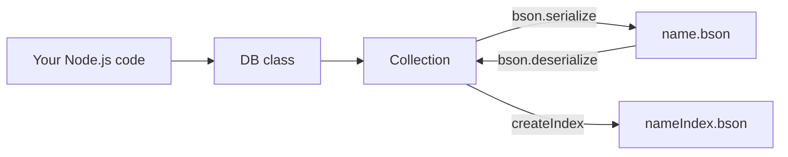

# youssefdb

A file-based NoSQL database engine for Node.js projects that need MongoDB-style collections without running a database server.

## Demo

TODO: screenshot

npm package: https://www.npmjs.com/package/youssefdb

## Architecture



Every operation reads the whole collection file from disk, changes the array in memory, and writes the whole file back. Each collection is one BSON file in the current working directory.

## Tech stack

- JavaScript (Node.js, CommonJS)
- `bson` for serialization and ObjectId generation
- Node.js `fs` for storage

## Run locally

This repository contains a single source file, `DB.js`, and no `package.json`.

```bash
git clone https://github.com/youssefseyam212/youssefdb.git
cd youssefdb
npm install bson
```

Then, in a script next to `DB.js`:

```js
const DB = require('./DB');
const db = new DB();
const users = db.collection('users');

users.insertOne({ name: 'Alice', age: 30 });
users.insertMany([{ name: 'Bob', age: 25 }, { name: 'Charlie', age: 35 }]);

users.find({ age: 30 });
users.findOne({ name: 'Alice' });

users.updateOne({ name: 'Alice' }, { $set: { age: 31 } });
users.updateMany({ age: 25 }, { $set: { age: 26 } });

users.deleteOne({ name: 'Alice' });
users.deleteMany({ age: 26 });

users.createIndex({ age: 35 });
```

Environment variables: none.

The engine is also published on npm as `youssefdb`. TODO: confirm the published package exposes the same API as `DB.js` in this repository.

## What I built

I wrote the whole engine myself:

- `DB` and `Collection` classes with a MongoDB-like API
- `insertOne`, `insertMany`, `find`, `findOne`, `updateOne`, `updateMany` (with `$set`), `deleteOne`, `deleteMany`
- Automatic `_id` generation with BSON `ObjectId`
- BSON persistence, one file per collection
- `createIndex`, which stores the ids of documents matching a field value in a separate index file

## Results

- Published on npm as `youssefdb`.
- Used as the storage layer of a food-delivery app.

## Limitations and next steps

- Queries support exact equality on top-level fields only; there are no operators such as `$gt` or `$in`.
- Updates support `$set` only.
- Every operation rewrites the whole collection file synchronously, so it is not suited to large collections or concurrent writers.
- No transactions, locking or schema validation.
- `readIndex()` currently reads the collection file instead of the index file, so saved indexes are not yet used by `find()`. Fixing this is the first next step.
- Add a `package.json` and tests to this repository.
